# Computer Vision: Detection, Segmentation & Tracking

A computer-vision project built around **PASCAL VOC 2012** and a separate vehicle-video demo. It compares training from scratch with transfer learning for object detection and semantic segmentation, then applies YOLOv8 + ByteTrack to vehicle tracking.

## What this project covers

- **Object detection:** YOLOv8n for `cow` and `motorbike`
- **Semantic segmentation:** DeepLabV3-ResNet50 for `background`, `cow`, and `motorbike`
- **Transfer learning:** scratch vs pretrained comparisons
- **Evaluation:** precision, recall, mAP, pixel accuracy, class IoU, and mean IoU
- **Video analytics:** YOLOv8 + ByteTrack with a simple movement-state heuristic

## Key results

### YOLOv8 object detection

| Model | Best Precision | Best Recall | Best mAP@0.5 | Best mAP@0.5:0.95 |
|---|---:|---:|---:|---:|
| Scratch | 0.746 | 0.555 | 0.620 | 0.335 |
| Pretrained | **0.895** | **0.801** | **0.865** | **0.613** |

Transfer learning produced a large improvement across every detection metric. The pretrained model also reached an overall F1 score of about **0.82** near a confidence threshold of **0.39**, compared with about **0.61** for the scratch model.

#### Pretrained YOLO training curves

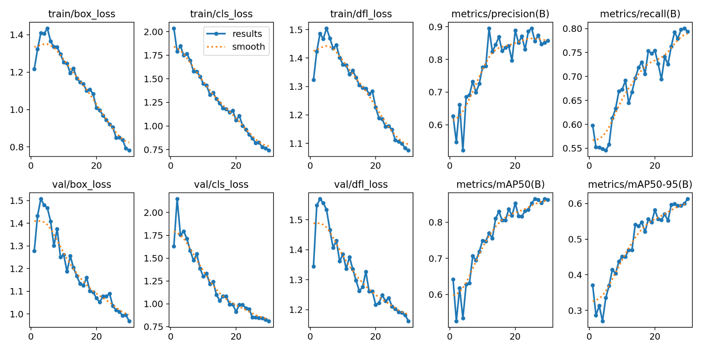

#### Precision-recall comparison

| Scratch | Pretrained |
|---|---|
| 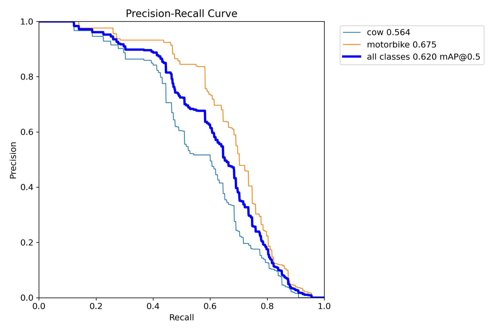 | 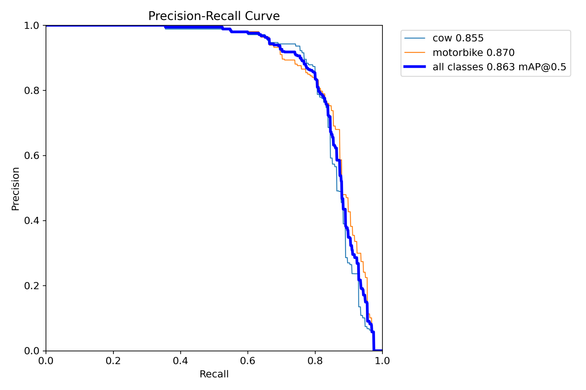 |

The pretrained PR curve reports AP@0.5 values of approximately **0.855 for cow** and **0.870 for motorbike**, with **0.863 mAP@0.5** across both classes.

### Qualitative detection examples

| Pretrained: cows | Pretrained: motorbike scene |
|---|---|
| 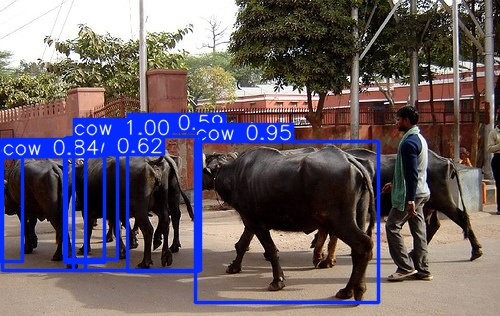 | 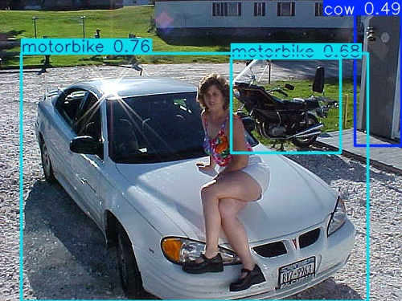 |

The second example also illustrates a useful failure case: a lower-confidence false positive can appear in a visually complex scene.

The scratch model produced substantially weaker qualitative detections in the supplied examples:

| Scratch example 1 | Scratch example 2 |
|---|---|
| 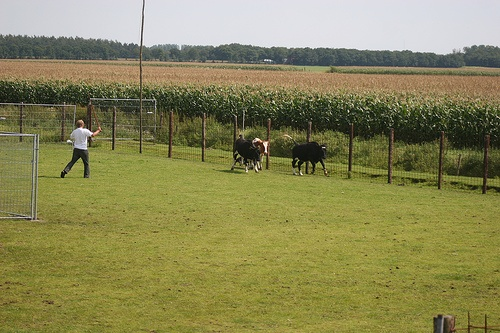 | 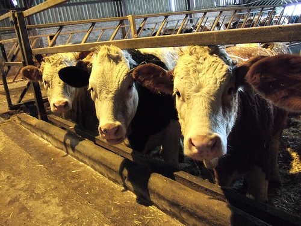 |

## DeepLabV3 semantic segmentation

| Model | Best epoch | Pixel accuracy | Mean IoU | Background IoU | Cow IoU | Motorbike IoU |
|---|---:|---:|---:|---:|---:|---:|
| Scratch | 10 | 0.791 | 0.423 | 0.777 | 0.218 | 0.156 |
| Pretrained | **6** | **0.927** | **0.723** | **0.904** | **0.543** | **0.454** |

The pretrained DeepLab model converged faster and segmented both target classes much more accurately.

| Scratch mean IoU | Pretrained mean IoU |
|---|---|
| 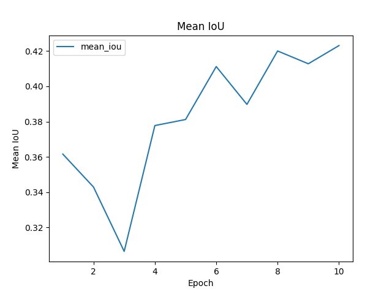 | 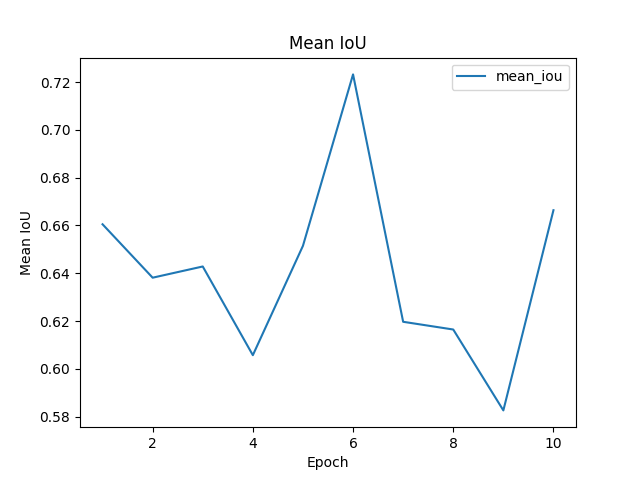 |

| Scratch class IoU | Pretrained class IoU |
|---|---|
| 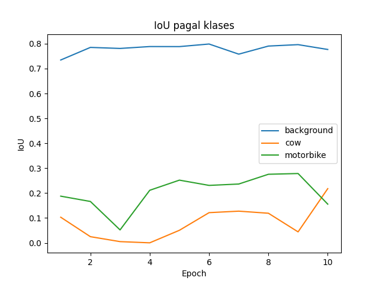 | 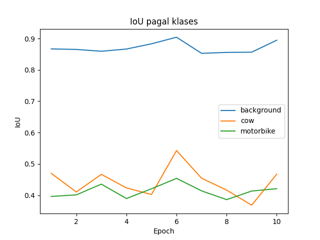 |

> **Reproducibility note:** the CSV files and figures in `results/` and `assets/` come from the original laboratory runs. The cleaned `train_deeplab.py` script in this repository aggregates the validation confusion matrix across the full validation set before computing IoU, which is a more standard dataset-level calculation. A rerun can therefore differ slightly from the archived laboratory metrics.

## Vehicle tracking demo

The video-analysis script uses a pretrained YOLOv8 model with **ByteTrack** to maintain object IDs for cars, buses, and trucks. A one-second track history is classified with a simple displacement rule.

Archived run summary:

| Track state | Count |
|---|---:|
| Standing | 219 |
| Moving | 27 |
| Standing and moving during the track | 195 |

The movement label uses a **20-pixel displacement threshold** by default. It is an image-space heuristic, not a physical speed estimate; results depend on resolution, camera perspective, and scene geometry.

## Repository structure

```text
computer-vision-detection-segmentation/
├── README.md
├── requirements.txt
├── .gitignore
├── data/
│   └── README.md
├── scripts/
│   ├── prepare_voc_detection.py
│   ├── prepare_voc_segmentation.py
│   ├── train_yolo.py
│   ├── predict_yolo.py
│   ├── train_deeplab.py
│   ├── predict_deeplab.py
│   ├── analyze_vehicles.py
│   └── test_setup.py
├── results/
│   ├── detection/
│   ├── segmentation/
│   └── video/
└── assets/
    ├── detection/
    └── segmentation/
```

## Setup

Create a virtual environment and install the dependencies:

```bash
python -m venv .venv
```

Windows:

```bash
.venv\Scripts\activate
pip install -r requirements.txt
```

macOS / Linux:

```bash
source .venv/bin/activate
pip install -r requirements.txt
```

Check the environment:

```bash
python scripts/test_setup.py
```

## Prepare PASCAL VOC data

Download and extract PASCAL VOC 2012 locally, then follow [`data/README.md`](data/README.md).

```bash
python scripts/prepare_voc_detection.py
python scripts/prepare_voc_segmentation.py
```

The generated dataset folders are intentionally excluded from Git.

## Train YOLOv8

From scratch:

```bash
python scripts/train_yolo.py --mode scratch
```

With pretrained weights:

```bash
python scripts/train_yolo.py --mode pretrained
```

Run predictions:

```bash
python scripts/predict_yolo.py \
  --weights runs/detection/pretrained/weights/best.pt \
  --output_name pretrained
```

## Train DeepLabV3

From scratch:

```bash
python scripts/train_deeplab.py --mode scratch --epochs 10
```

With pretrained weights:

```bash
python scripts/train_deeplab.py --mode pretrained --epochs 10
```

Example prediction command:

```bash
python scripts/predict_deeplab.py \
  --model_path runs/segmentation/deeplab_pretrained/best_model.pth
```

## Analyze a vehicle video

```bash
python scripts/analyze_vehicles.py --input data/video/input.mp4
```

The script writes an annotated video and a CSV summary to `runs/video/`.

## Notes

- Raw PASCAL VOC images, generated processed datasets, trained model checkpoints, and the Python virtual environment are intentionally **not committed**.
- Model outputs in this repository are retained as lightweight portfolio evidence.
- The project is intended as an educational computer-vision experiment rather than a production traffic-analysis system.
